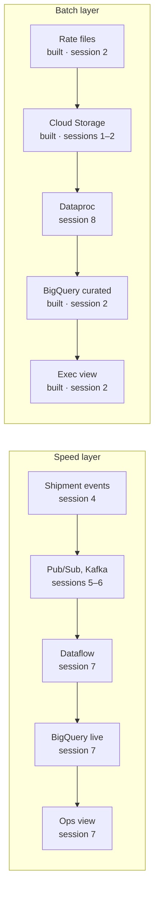

# Freight Data Platform 🚢📊

## 🏢 1. Project Overview

The **Freight Data Platform** is a cloud-based data engineering project designed to collect, process, store and analyse freight and shipment information.

In the logistics industry, companies receive large amounts of data from different sources, including shipping carriers, vessel tracking systems and transportation rate files.

This information helps companies understand shipment locations, delivery delays, transportation costs and carrier performance.

However, freight data arrives in different formats and at different times. Some information arrives continuously, while other information is provided through daily files.

To manage these requirements, this platform follows **Lambda Architecture**, which combines real-time data processing and batch data processing.

The platform has two main processing paths:

- **Speed Layer:** Processes shipment tracking events continuously to provide updated shipment information.
- **Batch Layer:** Processes scheduled carrier files to support historical analysis and business reporting.

The main goal is to provide operational teams with timely shipment information while helping management make better business decisions using historical data.

## 🎯 2. Business Objectives

The Freight Data Platform aims to achieve the following business objectives:

- **Shipment Monitoring:** Track shipment movements and monitor vessel activities.
- **Delay Detection:** Identify potential shipment delays and changes in estimated arrival times.
- **Carrier Performance Analysis:** Compare shipping carriers based on delivery reliability.
- **Transportation Cost Analysis:** Understand transportation rates and costs across different trade lanes.
- **Historical Reporting:** Analyse previous shipment records to identify trends and performance patterns.
- **Operational Decision-Making:** Help warehouse teams prepare for shipment delays and schedule changes.
- **Scalable Data Processing:** Process increasing amounts of freight information using cloud services.

## 🏗️ 3. System Architecture

The platform follows a modular **Lambda Architecture** consisting of two independent but complementary processing paths.

### 3.1 Speed Layer – Real-Time Processing ⚡

The Speed Layer handles continuous shipment tracking events.

Its purpose is to make the latest shipment information available to operational teams without waiting for scheduled batch processing.

**Data flow:**

Shipment Events → Pub/Sub / Kafka → Dataflow → BigQuery Live Tables → Operations View

**Components:**

1. **Shipment Events:** Provide updates about vessel departures, arrivals, shipment locations and delays.
2. **Pub/Sub and Kafka:** Receive and distribute shipment messages between data producers and processing systems.
3. **Dataflow:** Processes streaming events continuously, including filtering, transformation and handling late-arriving data.
4. **BigQuery Live Tables:** Store recent shipment information for operational queries.
5. **Operations View:** Displays shipment status and helps operations teams identify potential problems.

**Business example:**

Imagine a vessel travelling from Shanghai to Rotterdam. If the vessel experiences a delay, the carrier sends an updated shipment event.

The Speed Layer receives and processes this event, making the latest shipment information available to the operations team.

This helps warehouse employees prepare for changes in arrival schedules.

### 3.2 Batch Layer – Scheduled Data Processing 📦

The Batch Layer processes larger collections of data at scheduled intervals.

Its purpose is to prepare historical and structured freight information for business analysis and reporting.

**Data flow:**

Carrier Rate Files → Cloud Storage → Dataproc → BigQuery Curated Tables → Executive View

**Components:**

1. **Carrier Rate Files:** Contain transportation rates, carrier details and other scheduled business information.
2. **Google Cloud Storage:** Stores original files before processing.
3. **Dataproc:** Processes larger datasets using big-data technologies such as Apache Spark.
4. **BigQuery Curated Tables:** Store cleaned, organised and transformed information.
5. **Executive View:** Provides historical reports about carrier reliability, shipment delays and transportation costs.

**Business example:**

A carrier provides a daily file containing shipment and transportation information.

The Batch Layer stores the file, processes its contents and prepares the information for historical reporting.

Management can then compare carrier performance and analyse transportation costs.

## 🔄 4. How the Complete Data Pipeline Works

The platform processes information through the following workflow.

### Step 1 – Data Collection

The platform receives information from two main sources:

- Continuous shipment tracking events.
- Scheduled carrier rate and shipment files.

### Step 2 – Data Ingestion

Different services receive the incoming information.

- Pub/Sub and Kafka handle streaming messages.
- Cloud Storage stores incoming carrier files.

### Step 3 – Data Processing

The information follows the appropriate processing path.

- Dataflow processes real-time shipment events.
- Dataproc processes scheduled batch datasets.

### Step 4 – Data Storage

Processed information is stored in BigQuery.

- BigQuery Live Tables support recent operational information.
- BigQuery Curated Tables support historical and structured information.

### Step 5 – Data Analysis

The platform makes processed information available for analysis.

Operational teams monitor current shipments, while management analyses historical performance.

### Step 6 – Business Decisions

The final information helps businesses:

- Identify shipment delays.
- Prepare warehouse operations.
- Compare carrier reliability.
- Analyse transportation costs.
- Improve logistics planning.

## 🛠️ 5. Technologies Used

| Technology | Purpose |
|---|---|
| Google Cloud Platform (GCP) | Provides cloud infrastructure |
| Pub/Sub | Receives and distributes streaming messages |
| Apache Kafka | Supports event streaming and message distribution |
| Dataflow | Processes continuous shipment events |
| Google Cloud Storage | Stores original carrier files |
| Dataproc | Processes large batch datasets |
| BigQuery | Stores and analyses freight information |
| SQL | Queries, transforms and analyses data |
| Operations View | Displays current shipment information |
| Executive View | Displays historical business reports |

Each technology has a specific responsibility within the architecture.

## 📁 6. Architecture and Project Structure

The architecture documentation and related course materials are organised into different directories.

```text
cloud-computing-srh/
│
├── architecture/
│   ├── README.md
│   └── reference-platform.png
│
├── docs/
│   ├── metrics.md
│   ├── architecture/
│   │   └── greenleaf-architecture.md
│   └── adr/
│       └── 001-processing-pattern.md
│
├── event-generator/
│
├── sessions/
│   ├── 01-cloud-architecture-and-gcp-fundamentals/
│   ├── 02-storing-data-in-the-cloud/
│   ├── 03-batch-streams-and-architecture-patterns/
│   └── ...
│
└── README.md
```

**Important files:**

- `architecture/README.md`: Explains the overall Freight Data Platform reference architecture.
- `architecture/reference-platform.png`: Provides the visual reference architecture.
- `docs/metrics.md`: Contains Greenleaf Foods shipment performance metrics.
- `docs/architecture/greenleaf-architecture.md`: Explains the proposed architecture for Greenleaf Foods.
- `docs/adr/001-processing-pattern.md`: Documents the decision to use Lambda Architecture and its trade-offs.

## 📊 7. Speed Layer vs Batch Layer

| Feature | Speed Layer | Batch Layer |
|---|---|---|
| Processing | Real-time | Scheduled |
| Data source | Shipment events | Carrier files |
| Processing frequency | Continuous | Periodic |
| Main service | Dataflow | Dataproc |
| Storage | BigQuery Live | BigQuery Curated |
| Main purpose | Current shipment monitoring | Historical analysis |
| Main users | Operations team | Management |
| Example | Detecting vessel delays | Comparing monthly carrier performance |

Both layers are important because freight companies need recent shipment updates as well as accurate historical information.

## 🚀 8. Course Implementation Roadmap

The Freight Data Platform is developed gradually throughout the cloud computing course.

Each session introduces different cloud technologies and architectural concepts.

The overall learning progression includes:

1. **Cloud Architecture and GCP Fundamentals:** Understand cloud computing, Google Cloud services and the basic architecture.
2. **Storing Data in the Cloud:** Learn how to store and organise freight data using cloud storage and BigQuery.
3. **Batch, Streams and Architecture Patterns:** Understand batch processing, streaming, Lambda Architecture and Kappa Architecture.
4. **Event Generation:** Generate shipment events to simulate real-world freight activities.
5. **Messaging and Event Ingestion:** Understand how messaging systems receive and distribute events.
6. **Streaming Architecture:** Explore event-streaming technologies and their role in the platform.
7. **Real-Time Processing:** Process shipment events and make updated information available for analysis.
8. **Big Data Processing:** Explore large-scale data processing using Dataproc and related technologies.
9. **Integration and Analytics:** Connect the different components and analyse freight information.
10. **Production Readiness:** Consider monitoring, reliability, security, cost and operational requirements.

*Note: This section describes the overall learning progression. The exact implementation and services introduced in each session should be checked against the corresponding workshop instructions.*

## 📈 9. Expected Business Insights

The platform supports several useful business analyses.

| Analysis | Business Value |
|---|---|
| Average shipment delay | Understand delivery performance |
| On-time delivery percentage | Measure carrier reliability |
| Carrier comparison | Identify better-performing carriers |
| Trade lane performance | Identify routes with frequent delays |
| Transportation cost analysis | Understand shipping expenses |
| Historical shipment trends | Improve future logistics planning |

These insights help businesses understand their freight operations and identify opportunities for improvement.

## ⚖️ 10. Benefits and Challenges

### Benefits

- **Real-Time Visibility:** Operations teams can access recent shipment updates.
- **Historical Analysis:** Management can analyse previous shipment records.
- **Flexible Processing:** Different data sources can be processed using suitable methods.
- **Scalability:** Cloud services support growing data volumes.
- **Better Planning:** Early delay information helps warehouse teams prepare for disruptions.
- **Data-Driven Decisions:** Business decisions can be based on structured shipment information.

### Challenges

- **System Complexity:** Lambda Architecture requires maintaining two processing paths.
- **Data Consistency:** Both paths need consistent definitions and transformations.
- **Late Events:** Streaming systems must handle events that arrive later than expected.
- **Cloud Costs:** Processing and storage usage need to be monitored.
- **Data Quality:** Incomplete or incorrect carrier information can affect reporting.

---

# 👨‍💻 11. Individual Project – SHP04 Greenleaf Foods

## 11.1 Project Overview

As part of the Freight Data Platform course project, an individual customer-specific architecture was designed for **Greenleaf Foods (Customer ID: SHP04)**.

Greenleaf Foods is a packaged food business that imports and exports products with limited shelf life.

Because its products are time-sensitive, shipment delays can affect warehouse planning, inventory availability and business operations.

The individual project focuses on analysing existing freight shipment data, identifying delivery performance problems and proposing a suitable cloud data architecture.

The main objective is to help Greenleaf Foods improve shipment visibility, identify potential delays earlier and make better warehouse planning decisions.

## 11.2 Business Problem

Greenleaf Foods transports products across several international ocean freight routes.

The main business challenge is that shipment delays can create problems for warehouse operations.

For example, if a vessel arrives later than expected, the warehouse team may need to:

- Change warehouse receiving schedules.
- Adjust employee and resource planning.
- Reorganise inventory arrangements.
- Communicate updated arrival information.
- Prepare for possible disruptions in product availability.

Without timely shipment information, these decisions become difficult.

Therefore, Greenleaf Foods needs a data platform that provides updated shipment information and historical performance reports.

## 11.3 Customer Requirements

The individual project uses the following customer requirements:

| Requirement | Description |
|---|---|
| Customer ID | SHP04 |
| Customer | Greenleaf Foods |
| Business focus | Balanced |
| Transportation mode | Ocean |
| Shipment type | Packaged food with limited shelf life |
| Freshness target | 60 seconds |
| On-time delivery target | At least 65% on every trade lane |
| On-time definition | Actual arrival no more than 24 hours after scheduled arrival |
| Monthly budget | $30 |

The 60-second freshness requirement means that shipment information should become available to the operations team within 60 seconds of the relevant tracking event being received.

The 65% reliability requirement means that each trade lane should achieve an on-time delivery percentage of at least 65%.

## 11.4 Trade Lanes and Shipment Data

The analysis focuses on four international ocean freight trade lanes.

| Origin | Destination | Trade Lane |
|---|---|---|
| GBFXT | CNSHA | North Europe–Asia |
| CNSHA | NLRTM | Asia–North Europe |
| NLRTM | USHOU | Transatlantic |
| CNYTN | USLAX | Transpacific |

The shipment information was analysed using BigQuery.

The analysis joined the `freight.bookings` and `freight.schedules` tables using `schedule_id` and filtered the records for customer `SHP04`.

This allowed the project to compare actual shipment arrival times against scheduled arrival times.

## 11.5 Shipment Performance Analysis

The BigQuery analysis returned the following results:

| Trade Lane | Shipments | Average Delay | On-Time Rate |
|---|---:|---:|---:|
| North Europe–Asia | 29 | 38.5 hours | 79.3% |
| Asia–North Europe | 31 | 33.5 hours | 54.8% |
| Transatlantic | 30 | 48.4 hours | 56.7% |
| Transpacific | 24 | 47.3 hours | 45.8% |

**Total analysed shipments: 114**

### Understanding the Results

The customer requires every trade lane to achieve at least 65% on-time delivery.

The analysis shows that only one of the four trade lanes meets this requirement.

**1. North Europe–Asia (GBFXT → CNSHA)**

- On-time rate: 79.3%.
- Performance is 14.3 percentage points above the target.
- This is the best-performing trade lane in the analysis.

**2. Asia–North Europe (CNSHA → NLRTM)**

- On-time rate: 54.8%.
- Performance is 10.2 percentage points below the target.
- This lane needs improvement in delivery reliability.

**3. Transatlantic (NLRTM → USHOU)**

- On-time rate: 56.7%.
- Performance is 8.3 percentage points below the target.
- Average delay is 48.4 hours, the highest among the four lanes.

**4. Transpacific (CNYTN → USLAX)**

- On-time rate: 45.8%.
- Performance is 19.2 percentage points below the target.
- This is the weakest-performing trade lane.

## 11.6 Main Business Findings

The analysis identifies several important findings:

- Three out of four trade lanes do not meet the 65% on-time delivery target.
- The Transpacific lane has the lowest on-time delivery rate at 45.8%.
- The Transatlantic lane has the highest average delay at 48.4 hours.
- North Europe–Asia is the only lane that meets the reliability target.
- The results indicate that Greenleaf Foods needs better shipment visibility and earlier information about potential delays.

The project also includes carrier-level analysis. Atlas and Northwind together account for 48 of the 114 analysed bookings, with 18 on-time arrivals (37.5%).

Carrier-level results should be interpreted carefully because the number of shipments in individual carrier and lane combinations is limited.

**Important:** The proposed architecture can identify potential delays and notify warehouse teams. It cannot directly guarantee that vessels arrive on time.

## 11.7 Proposed Architecture for Greenleaf Foods

Based on the business requirements and shipment analysis, the proposed solution uses **Lambda Architecture**.

Lambda Architecture is suitable because Greenleaf Foods receives two different types of information:

1. Continuous shipment tracking events.
2. Scheduled daily carrier files.

The architecture separates these into a live processing path and a batch processing path.

### A. Live Processing Path – Real-Time Shipment Monitoring ⚡

**Data flow:**

Carrier Tracking Events → Pub/Sub → Dataflow Streaming → Event-Time Processing → BigQuery Live Tables → Operations Dashboard → Delay Alerts → Warehouse Team

**Responsibilities:**

- Receive shipment tracking updates.
- Process events continuously.
- Handle late and out-of-order events.
- Store recent shipment information in BigQuery.
- Identify potential delays.
- Notify warehouse teams when arrival schedules may be affected.

**Target:** Make relevant shipment information available within 60 seconds.

### B. Batch Processing Path – Historical Analysis 📦

**Data flow:**

Daily Carrier Files → Cloud Storage → BigQuery Load Jobs and SQL Transformations → BigQuery Curated Tables → Executive Performance Reports

**Responsibilities:**

- Store original carrier files.
- Process scheduled shipment and rate information.
- Clean and organise historical data.
- Calculate average shipment delays.
- Measure carrier reliability.
- Generate trade lane performance reports.

This path supports management decisions using historical information.

## 11.8 Why Lambda Architecture Was Selected

Two architecture patterns were considered.

### Lambda Architecture

- Uses separate live and batch processing paths.
- Supports continuous shipment events and scheduled files.
- Provides recent operational information and historical analysis.
- Requires maintaining two processing paths.

### Kappa Architecture

- Uses one main streaming processing path.
- Can rebuild results by replaying stored events.
- Can simplify processing logic when all relevant data is available as events.
- Is less suitable for the current design because Greenleaf receives scheduled carrier files as well as live tracking events.

### Final Decision: Lambda Architecture

The main reason is that Greenleaf Foods has mixed data sources.

A separate batch path handles daily files, while the live path handles shipment tracking events.

This decision is documented in:

`docs/adr/001-processing-pattern.md`

## 11.9 Cost and Operational Considerations

Greenleaf Foods has a monthly budget of $30.

The proposed architecture therefore needs careful cost management.

Important considerations include:

- Control the amount of data processed by Dataflow.
- Avoid unnecessary streaming computations.
- Monitor BigQuery storage and query consumption.
- Use scheduled batch processing for historical files.
- Monitor Cloud Storage usage.
- Review the costs of managed services before deployment.

The architecture is a proposed design. Its actual monthly cost must be validated against the $30 budget before production deployment.

## 11.10 Individual Project Deliverables

The individual project is documented through three main deliverables:

| File | Purpose |
|---|---|
| `docs/metrics.md` | Documents shipment performance, lane-level delay and on-time delivery results |
| `docs/architecture/greenleaf-architecture.md` | Explains the proposed Greenleaf Foods data architecture |
| `docs/adr/001-processing-pattern.md` | Documents the decision to use Lambda Architecture and its trade-offs |

These documents provide the business evidence, architecture design and technical reasoning behind the individual project.

## 11.11 Expected Business Benefits

The proposed solution can help Greenleaf Foods in several ways:

- **Improved Shipment Visibility:** Access updated shipment information.
- **Earlier Delay Detection:** Identify potential disruptions sooner.
- **Better Warehouse Planning:** Give warehouse employees more time to adjust schedules.
- **Carrier Performance Monitoring:** Identify weaker-performing carriers and trade lanes.
- **Historical Analysis:** Understand delivery trends over time.
- **Better Business Decisions:** Use shipment information to support logistics planning.

## 11.12 Individual Project Conclusion

The SHP04 Greenleaf Foods project demonstrates how data engineering and cloud architecture can address a real freight business problem.

The BigQuery analysis of 114 shipments identified that three out of four trade lanes fail to achieve the required 65% on-time delivery target.

Based on these findings, a Lambda Architecture was proposed to combine real-time shipment monitoring with scheduled historical data processing.

The live processing path supports the 60-second freshness requirement, while the batch processing path supports historical reporting and carrier performance analysis.

The proposed solution gives Greenleaf Foods a foundation for better shipment visibility, earlier delay detection and improved warehouse planning.

**The main objective is to transform freight shipment data into useful business information that helps Greenleaf Foods respond to delays and improve its logistics operations.**

## 📝 12. Overall Conclusion

The Freight Data Platform provides a structured approach to collecting, processing, storing and analysing freight information.

By combining the Speed Layer and Batch Layer through Lambda Architecture, the platform supports both real-time shipment monitoring and historical business reporting.

The general architecture provides the technical foundation, while the individual SHP04 Greenleaf Foods project demonstrates how this architecture can be adapted to a specific customer's business requirements.

The analysis of Greenleaf Foods shipment data identifies delivery reliability problems, and the proposed solution provides a foundation for earlier delay detection and improved warehouse planning.

Together, these components demonstrate how cloud computing, data engineering, batch processing, stream processing and analytics can transform raw freight data into useful business information.

**Project:** Freight Data Platform  
**Individual Customer:** SHP04 – Greenleaf Foods  
**Architecture Pattern:** Lambda Architecture  
**Cloud Platform:** Google Cloud Platform (GCP)  
**Focus:** Data Engineering, Batch Processing, Stream Processing and Analytics


# Reference architecture

This is the platform everyone starts from in session 3. It's a Lambda architecture: tracking events stream because operations needs them live, and rate files arrive daily because that's how carriers send them.


- **Speed layer:** shipment events flow through Pub/Sub and Kafka into Dataflow, which writes live tables in BigQuery for the ops view.
- **Batch layer:** rate files land in Cloud Storage, Dataproc processes them, and the results go into curated BigQuery tables for the exec view.

The boxes marked "built" are the ones you have after sessions 1 and 2. The others come session by session, as labelled. Session 10 makes the whole platform production-ready.

Your own design can change this, as long as you can justify the change for your shipper.

## Copy and adapt

The same diagram in Mermaid, if you'd rather edit text than draw. Paste it into a Markdown file in your fork and GitHub draws it.


