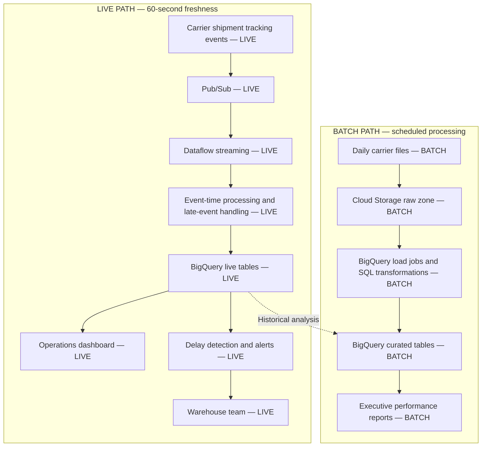

# Greenleaf Foods — Proposed Data Architecture

## 1. Architecture pattern: Lambda

Greenleaf Foods needs shipment information within 60 seconds. Historical carrier files and performance reports can be processed on a schedule.

The proposed Lambda architecture has two paths: a live path for shipment tracking events and a batch path for historical files.

## 2. Architecture diagram

## 3. Explanation of components

### Live processing path

1. Carrier shipment tracking events provide updates about vessel departures, arrivals and delays.
2. Pub/Sub receives shipment events.
3. Dataflow processes the events continuously.
4. Event-time processing handles late and out-of-order events.
5. BigQuery live tables store the latest shipment information.
6. The operations dashboard displays shipment status.
7. Delay detection identifies shipments that may arrive more than 24 hours late.
8. Alerts notify the warehouse team so they can prepare and re-plan.

**Target:** Shipment information should become available within 60 seconds.

### Batch processing path

1. Carriers provide daily files containing shipment and rate information.
2. Cloud Storage stores the original files.
3. BigQuery load jobs and SQL transformations process the files on a schedule.
4. BigQuery curated tables store cleaned historical information.
5. Executive reports show carrier reliability, average delay and lane performance.

## 4. Why this architecture?

- Greenleaf receives both live shipment events and scheduled carrier files.
- Live processing supports the 60-second freshness target.
- Batch processing supports historical analysis and reporting.
- BigQuery can be used for both live operational data and historical analytics.
- Managed services help avoid the cost of running unnecessary clusters.

## 5. Cost and operational considerations

The monthly budget is $30. The design should use managed services with controlled processing volumes.

Actual service costs must be checked using the Google Cloud pricing calculator. Monitoring and budget alerts should be configured to prevent unexpected spending.

## 6. Limitations and trade-offs

- Lambda requires two processing paths.
- Late and out-of-order events need careful handling.
- The system can detect and report delays, but cannot guarantee that vessels arrive on time.
- The batch path may not show the latest information immediately.
- The actual end-to-end live processing latency must be tested against the 60-second target.
